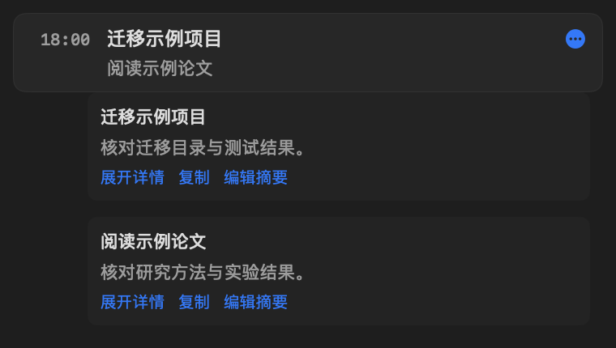
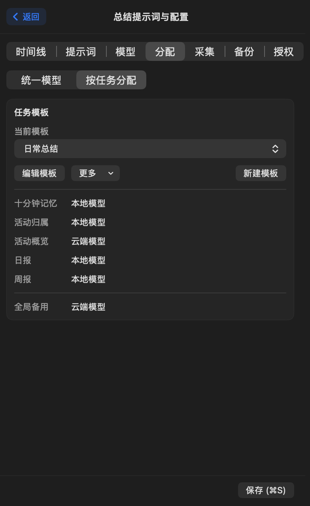

# ComputerHistory

- 核心Idea来源：[ChatGPT Computer History](https://learn.chatgpt.com/docs/customization/computer-history)

> TODO：项目实际演示、README等文档去除GPT味 <br>
> 核心开发动力：想看看自己每天玩电脑的时间都浪费在哪里了呀，好让AI大人视奸和鞭策我呀 <br>
> 以下均由deepseek-v4.1-flash, gpt-6.1-sol/6.1-astra/6.2-sol, gemini-3.8-flash等编写，开发周期比较长了我也记不清都哪些模型改过文档了，也许我需要一个agent git blame

---

macOS 本地活动记录工具。通过 Accessibility（辅助功能，简称 AX）读取前台应用的界面文本，记录窗口变化、点击、快捷键和可归因的文本变化，按时间段保存。辅助功能缺少正文的应用可显式启用[本地窗口文字识别](docs/collector.md#采集行为与局限)。可选接入[本机 ActivityWatch](docs/collector.md#activitywatch-补充来源)补充窗口与空闲记录。支持 DeepSeek 和兼容接口的自托管模型生成记忆摘要，并在菜单栏查看时间线、逐次请求和费用。

## 界面演示

| 活动详情 | 按任务分配 |
| --- | --- |
|  |  |

截图使用示例数据。

## 使用前了解

- 普通文本框、窗口标题、页面内容和访问地址可能以明文保存。默认屏蔽名单不能保证排除所有敏感内容。
- `collect` 不调用模型；`memorize`、`narrative` 以及 `supervise` 的生成任务会向已配置的模型服务发送活动内容。`--no-model` 可禁止模型请求。
- 暂停记录只阻止新的采集；恢复后当前界面仍可能被完整读取。已有记录不会因暂停而删除。

详见 [隐私与安全边界](docs/privacy.md)。

## 构建和验证

预编译程序及启动方法见[下载与运行](docs/distribution.md)；预编译包只提供 Apple Silicon（`arm64`）版本。源码验证结果见 [CI](https://github.com/Chesszyh/ComputerHistory-release/actions/workflows/ci.yml)。

需要 macOS 13 或更高版本、Swift 6 工具链。进程集成测试和菜单栏启动脚本另需 Python 3。Swift 包不依赖第三方包。

日常使用请先按[下载与运行](docs/distribution.md)安装应用，打开应用后完成授权并开始记录。源码构建与验证在仓库目录执行：

```bash
bash scripts/build.sh -c release
bin_dir="$(swift build -c release --show-bin-path)"
swift test
python3 scripts/test-process-control.py "$bin_dir/computer-history"
```

常规测试使用合成数据，不需要模型密钥。三项私有兼容性样本测试默认跳过；集成测试使用临时目录和测试进程，以本地模拟接口验证生成路径，不操作真实运行服务。

菜单栏可[删除时间线中的总结](docs/collector.md#删除时间线总结)，并在[模型设置](docs/collector.md#模型与用量配置)中配置总结使用的模型。

## 开始记录

先检查权限，再进行一次短时采集。检查命令报告系统权限预检状态，不代表所有应用读取或后台事件监听已验证成功。应用版提供首次授权引导，安装及升级见[下载与运行](docs/distribution.md)。

```bash
"$bin_dir/computer-history" --check
"$bin_dir/computer-history" collect --seconds 15
"$bin_dir/computer-history" --status
```

在“系统设置 → 隐私与安全性”中检查辅助功能和输入监控权限；具体需授权的程序受启动方式及系统权限归属影响。查看数据目录中的 `collector.log` 确认是否存在读取或监听错误。

默认数据目录为 `~/.computer-history`。CLI（命令行接口）支持 `--out <目录>`；同一实例的启动、状态、停止及生成命令应使用同一个目录。

```bash
# 后台采集并定期生成本地事实摘要，禁止模型请求
"$bin_dir/computer-history" supervise --daemon --no-model

# 停止监督进程和采集器，等待当前事件段封口
"$bin_dir/computer-history" --stop

# 启动菜单栏界面，读取默认数据目录
./scripts/menubar.sh
```

安装版的授权页提供“开始记录”，由独立后台服务管理采集。菜单栏的登录启动开关只控制菜单栏。可用 `./scripts/menubar.sh --stop` 停止身份可验证的菜单栏实例；旧版未登记身份的实例需从界面退出后再启动新版。采集配置保存后由运行实例自动重新加载；菜单栏运行开关也由进程定期读取。

## 记忆与时间线

可安装 [跨 Agent 历史查询 Skill](docs/agent-skill.md)，在其他项目的 Coding Agent 中按需检索本机摘要与原始证据。

历史活动支持[固定十分钟或连续任务两种模式](docs/collector.md#时间线模式编辑与复制)，保存后可选择重算范围；摘要单击复制、双击编辑；连续模式支持任务关联和片段归属纠错，底栏可多选后复制。滚动到底部时自动加载更早记录。锁屏和长时间无操作分别记录离开原因；具体判定和存储见[采集行为](docs/collector.md#采集行为与局限)。

```bash
# 不联网：为已封口的段生成事实摘要
"$bin_dir/computer-history" memorize --no-model --limit 6

# 使用当前模型生成指定日期的日报；当天生成截至当前的预览
"$bin_dir/computer-history" report --day 2026-10-18

# 导出给其他 AI 的材料，不调用模型
"$bin_dir/computer-history" export --day 2026-10-18 --material --file activities.md

# 检查已有十分钟记忆的自引用、未来引用和成环
"$bin_dir/computer-history" verify
```

菜单栏“日报、周报与导出”可生成、查看、复制报告，或复制给其他 AI 的活动材料，并导出 Markdown／TXT。监督进程自动补齐已结束时段的日报、周报。可选的 GitHub 私有备份默认关闭，在“设置 → 总结提示词与配置 → 备份”设置仓库，并可直接用设置区开关启停。详细行为与命令见[报告、导出与备份](docs/collector.md#报告导出与备份)。

在菜单栏打开“设置 → 总结提示词与配置 → 模型”。先在「模型」添加端点和模型，再切到「分配」。想让所有总结共用同一对主备模型，选「统一模型」。需要给活动归属、日报等任务分配不同模型，选「按任务分配」并保存模板。配置步骤见[选择模型和任务模板](docs/collector.md#选择模型和任务模板)。

命令行可以通过数据目录中的 [`model.json`](docs/collector.md#modeljson-配置示例)配置模型。未配置服务时，也可用 `DEEPSEEK_API_KEY` 接入，并通过 `DEEPSEEK_MODEL` 与 `DEEPSEEK_BASE_URL` 指定模型和地址。默认值见 [DeepSeekClient.swift](Sources/ComputerHistoryCore/DeepSeekClient.swift) 的 `defaultModel` 和 `defaultBaseURL`。

已配置模型时，生成任务会向所选模型发送活动材料。可用 `--no-model` 禁用模型请求。菜单栏的“总结用量与费用”可查看每次请求的实际输入、输出、token 用量和费用估算。备用模型、失败重试和计费规则见[模型与用量配置](docs/collector.md#模型与用量配置)。

用量页支持今天、昨天、本周（周一起）和本月筛选，并可选择任务类型及主模型／降级请求。合计随筛选范围变化，请求按日期和任务分组展开。详情先显示模型输出，原始来源、系统提示词和原始输入默认折叠。分组和请求详情的折叠标题整行可点击展开，查看请求详情后返回保留展开状态和浏览位置。菜单栏“设置 → 总结提示词与配置”提供提示词、模型和采集表单；配置文件编辑位于高级选项，生效方式见[模型与用量配置](docs/collector.md#模型与用量配置)。

## 文档

- [采集、配置和存储](docs/collector.md)
- [隐私、外发和数据删除边界](docs/privacy.md)
- [跨 Agent 历史查询 Skill](docs/agent-skill.md)
- [开发与测试](CONTRIBUTING.md)
- [更新日志](CHANGELOG.zh.md) · [Changelog (English)](CHANGELOG.md)
- [安全问题反馈](SECURITY.md)
- [来源与第三方内容](docs/provenance.md)

## 许可证

本项目使用 [MIT License](LICENSE)。
